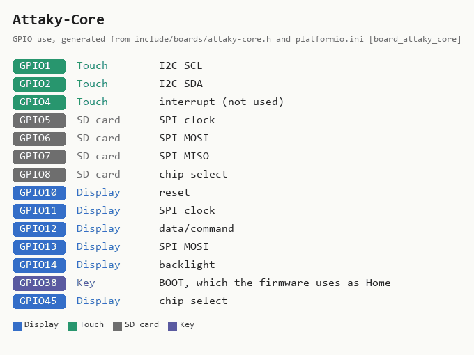

# Attaky Core (Cyber Deck Plus) -- 2.0-inch, capacitive touch, one USB-C

**How to recognise it:** not a bare board but a finished handheld in a case,
built from Attaky's snap-together modules. The Core is the top half -- a
2.0-inch screen, a five-way D-pad and four keys along the top edge -- and on
the Cyber Deck Plus it sits above a gamepad and a 48-key keyboard, with a
Media I/O module (microSD, speaker, microphone) on the back and a 1000 mAh
battery module. One USB-C socket, on the Core, through a CH340X USB-serial
chip. The ESP32-S3 module inside is the same N16R8 part as the Freenove board.

**In the installer:** "2.0-inch, capacitive touch, one USB-C port -- Attaky
Core 1.0 in a Cyber Deck Plus".

**Which modules this build expects:** the Core, and Media I/O on the back for
the SD slot and the speaker. The Expand modules share their pins, so before
either is brought up the firmware looks for the two others, without driving
anything they own: the FM/AM module's tuner on that module's own I2C bus (IO42/IO41),
and the LoRa/GPS module's GPS, which sends position sentences on IO17
unasked and is listened to for a second and a half. Finding either leaves
the SD slot alone and the console silent for that boot -- the speaker's I2S
lines are that module's GPS, radio or tuner lines -- and the serial log says
`[expand] module=FM-AM` or `module=LoRa-GPS`, `sd=skipped audio=skipped`.
So this firmware runs on Attaky's LoRa and radio builds of the Core too,
without SD or sound. Media I/O cannot be recognised -- it has nothing a host
can ask -- so finding neither (`module=none-or-media`) brings both up as
before. The keyboard and the gamepad are read when they are clipped on, and
the battery module's fuel gauge whenever it answers.

**One image for every Attaky build.** Which modules are on is not something
the firmware is told: the board profile says where each one would be, and boot
looks. Every module -- keyboard, gamepad, the Power module's fuel gauge, and
each Expand module -- is one entry in a module table with its own probe and a
statement of what it gives the console (keys, typing, a battery reading, the
SD slot, sound); nothing a module gives is used unless its probe found it. The
serial log says what was found, one `[module]` line each plus the `[expand]`
line, and **System Info -> Board -> Module** and **About -> Modules** list
every module with "Found", "Not found", or "Assumed" for Media I/O, which can
only be inferred. Supporting a module Attaky adds later is one driver file in
`src/hal/modules/` and its addresses in `include/boards/attaky-core.h`.

## What has been checked on this board

**Nothing yet.** The profile was written on 2026-10-23 from Attaky's published
documents, before a device was available, and it builds. Every pin agrees with
two firmwares Attaky ship for this hardware -- their Retro-Go target and their
MeshCore variant -- but agreement on paper is not a board that has been seen to
draw and respond. Until somebody has flashed it, treat every line below as a
claim, and the four things most likely to need changing as:

- **Which way up the picture is**, in all four positions of the Layout button.
  The panel is mounted half a turn round, and Attaky warn that the rotation
  number depends on the display library.
- **Whether touch lands where you tap** in each of those positions. The
  controller's reset is driven through an I2C expander, which no other board
  here does.
- **The colours.** Inversion on and RGB order follow Attaky's Retro-Go init. A
  photo-negative picture means inversion is wrong; red and blue exchanged means
  the order is.
- **The SD card**, which is wired in SPI mode on lines the Expand modules share
  -- and the boot line `[expand] module=none-or-media sd=allowed audio=allowed`
  before it, which should read that way with Media I/O fitted. On a LoRa or
  radio build it should name that module and say `skipped` twice.

**Sound comes from the Media I/O module's NS4168 amplifier**, driven as plain
I2S with no codec: BCLK IO17, word select IO21, data IO18, at 16 kHz. None of
it has been heard. What to listen for:

- **Is there any sound at all?** The boot phrase, "Let's play Braino!", is the
  first test. Silence with `[audio] I2S amp up ...` in the serial log points at
  the pins or the frame format, not the synthesiser.
- **Is it the right pitch and length?** A cue that sounds like a click, or the
  phrase coming out fast and high, means the I2S clock is not running at the
  rate it was asked for -- the fault the CYD boards' DAC had. Timing the drain
  of a known number of frames is the check; `i2s_get_clk()` is not.
- **How loud is the top of the slider?** The volume ceiling is 50% because
  nobody has heard this speaker yet. Play the boot phrase and the piano at the
  top of the slider and raise `maxVolume` in `include/boards/attaky-core.h`
  until just below where it distorts, as the other boards' ceilings were set.
- **Does anything pop or hiss when idle?** The amplifier has no enable line, so
  it is powered for as long as the board is.

**The Core's own keys drive the launcher:** the D-pad moves a ring between
the tiles, Enter opens one, and the top-left shoulder key (L1) is Back -- Home
from any other screen, as BOOT is. Worth checking that each direction moves
the way it points, in landscape and in portrait.

**So does the gamepad, when it is clipped on.** Its D-pad, A (Enter) and B
(Back) feed the same keys as the Core's, so they move the same ring, repeat
the same way when held, and turn with the screen the same way. It is two
TCA9555 expanders, left half at 0x22 and right at 0x26, from Attaky's Gamepad
(Bottom) datasheet: Up P0_5, Down P0_2, Left P0_4, Right P0_3; A P0_3, B P0_4.
X, Y, the shoulders and the FN keys are not read, and each half's LED is left
off. Worth checking on a device:

- the boot log says `[module] gamepad present` with it on and `absent` with
  it off, and System Info -> Board -> Module agrees;
- each direction on the gamepad moves the ring the way the same direction on
  the Core's D-pad does, in landscape, portrait and flipped -- the gamepad's
  directions are taken to share the Core's frame, which nobody has seen yet;
- A opens a tile and B goes Home from a game.

**The battery badge reads the Power module's fuel gauge**, a MAX17048 at 0x36
on the touch bus, rather than a voltage divider -- the Core has none. The
battery task reads its cell voltage and state of charge every two seconds and
the badge shows the state of charge as the gauge reports it, through the same
deadband and the same 15% / 5% warnings as every other board. A gauge that
does not answer -- the module unclipped -- is no reading: no badge and no
warning, never an empty battery. Worth checking on a device:

- the serial log says `[battery] fuel gauge at 0x36 answering` at boot, and
  System Info -> Board -> Power shows a voltage near the cell's and
  "Fuel gauge MAX17048";
- the percentage agrees roughly with Attaky's own firmware on the same charge;
- unclipping the Power module (on USB) takes the badge away within a couple of
  seconds and logs `not answering`, and clipping it back brings it back;
- touch is not slowed or disturbed while the gauge is being read -- the two
  share one I2C bus from two tasks, with Wire's own lock between them.

**A short press of the power key locks the console**, as the on-screen Lock
button does. Its long press is Attaky's hardware power switch and the
firmware never sees it. Worth checking that a short press goes dark and
wakes to Hold to unlock, and that a long press still switches off.

**The status LED answers as it does on the other boards** -- green and red
with the right and wrong sounds, the screen saver's rally colour -- through
the same I2C expander as the keys. Each colour is on or off there, so it shows
seven colours rather than a blend. Worth checking that green is green: red,
green and blue are stated as the catalog states them.

**The keyboard types into every text field:** a player's name, a Nearby
peer's name, both admin PIN pads and the Wi-Fi password, with Delete and Enter
doing what DEL and OK do. The name fields take capitals, digits and spaces, as
their on-screen keypad does; the password takes exactly what is typed, with
Shift for capitals. The on-screen keypad stays: the module clips off, and the
firmware checks for it at boot.

Left out on purpose, not broken: the D-pad and the gamepad on any screen but
the launcher, and the gamepad's other eight keys. Touch is the console's input
on every board.

## Sources

Checked 2026-10-23. Attaky states no licence for its pictures or documents, so
these are linked, not copied. Its firmware-builder repository is Apache-2.0
and its Retro-Go overlay GPL-2.0; only facts are taken from either.

| Source | Archived copy | What it gives |
|---|---|---|
| [Attaky shop: Cyber Deck Plus](https://shop.attaky.com/products/attaky-cyber-deck-plus) | -- | what is in the box |
| [Attaky manual: Cyber Deck Plus 1.0](https://manuals.attaky.com/docs/complete-builds/cyber/deck-plus) | -- | controls, buttons, power |
| [Attaky datasheets](https://docs.attaky.com/docs/datasheets) | -- | Core, Media I/O, Gamepad, Keyboard and Standard Cell modules |
| [Attaky I2C address map](https://docs.attaky.com/docs/frame-and-connections/i2c-address-map) | -- | every device on the shared bus |
| [Hardware catalog](https://github.com/Attaky-Module/Attaky-Firmware-Builder/blob/main/shared/hardware-catalog.md) | -- | the host pin map, including the display's SPI pins |
| [Retro-Go target](https://github.com/Attaky-Module/retro-go/blob/master/overlay/components/retro-go/targets/ATK-RetroSeries-V1/config.h) | -- | a working display, SD and audio pin set |
| [MeshCore variant](https://github.com/Attaky-Module/MeshCore/tree/main/variants/attaky_core) | -- | a working display, I2C and button set |

<!-- BEGIN GENERATED by tools/gen_board_docs.py -- do not edit by hand -->

### From the firmware profile

| | |
|---|---|
| Firmware name (`BOARD_NAME`) | `Attaky-Core` |
| Installer / PlatformIO environment | `app_attaky_core` |
| Device-id tag | `ATK-...` |
| Panel | 240 x 320, ST7789 driver |
| Touch | capacitive, I2C; reset on port P1_3 of the I2C expander at 0x59 |
| Sound | I2S amplifier with no codec (BCLK GPIO17, WS GPIO21, data GPIO18) |
| RGB LED | ports P1_0 red, P1_1 green, P1_2 blue of the I2C expander at 0x59, each channel on or off |
| Battery sense | MAX17048 fuel gauge, I2C address 0x36 on the touch bus |
| Flash | 16 MB |

| GPIO | Used for |
|---|---|
| 1 | Touch: I2C SCL |
| 2 | Touch: I2C SDA |
| 4 | Touch: interrupt (not used) |
| 5 | SD card: SPI clock |
| 6 | SD card: SPI MOSI |
| 7 | SD card: SPI MISO |
| 8 | SD card: chip select |
| 10 | Display: reset |
| 11 | Display: SPI clock |
| 12 | Display: data/command |
| 13 | Display: SPI MOSI |
| 14 | Display: backlight |
| 17 | Audio: I2S BCLK; Module check: LoRa/GPS module's NMEA, listened to (input only) at boot |
| 18 | Audio: I2S data out |
| 21 | Audio: I2S LRCK |
| 38 | Key: BOOT, which the firmware uses as Home |
| 41 | Module check: FM/AM module's own I2C SCL, probed once at boot |
| 42 | Module check: FM/AM module's own I2C SDA, probed once at boot |
| 45 | Display: chip select |

### Photos

None yet. Add your own as `docs/boards/img/Attaky-Core-front.jpg` (and `-back.jpg`)
and re-run `python tools/gen_board_docs.py`.

<!-- END GENERATED -->

<!-- SPDX-License-Identifier: GPL-3.0-or-later -->
<!-- SPDX-FileCopyrightText: Copyright (C) 2026 iamankushpandit -->

---

*Part of [Braino!](https://github.com/iamankushpandit/Gume) by [iamankushpandit](https://github.com/iamankushpandit). Copyright © 2026 iamankushpandit, licensed [GPL-3.0-or-later](https://github.com/iamankushpandit/Gume/blob/main/LICENSE) alongside the code — reuse of this document, in whole or in part, must keep this attribution and stay under the same licence. See [NOTICE.md](https://github.com/iamankushpandit/Gume/blob/main/NOTICE.md).*
