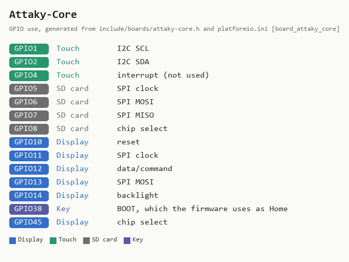

# Attaky Core (Cyber Deck Plus) -- 2.0-inch, capacitive touch, one USB-C

**How to recognise it:** not a bare board but a finished handheld in a case,
built from Attaky's snap-together modules. The Core is the top half -- a
2.0-inch screen, a five-way D-pad and four keys along the top edge -- and on
the Cyber Deck Plus it sits above a gamepad and a 48-key keyboard, with a
Media I/O module (microSD, speaker, microphone) on the back and a 1000 mAh
battery module. One USB-C socket, on the Core, through a CH340X USB-serial
chip. The ESP32-S3 module inside is the same N16R8 part as the Freenove board.

**Not in the installer.** This build is not published: the web installer
does not list the board, and its update check is told of no version. Build
and flash it from source with `pio run -e app_attaky_core -t upload`; CI also
keeps each run's image as a downloadable artifact. When it is published, the
installer will label it "2.0-inch, capacitive touch, one USB-C port -- Attaky
Core 1.0 in a Cyber Deck Plus".

**Its version:** the same as every other board, with the device after a
`+` -- `5.14.0+attaky` on About, System Info and the `[boot]` line. The
environment is `custom_env_kind = product`: every release carries its image,
the web installer offers it, Attaky publish it on their
[firmware store](https://fwstore.attaky.com/en/), and the update check tells
its owner when a newer release is out, as on every board.

**Which modules this build expects:** the Core, and Media I/O on the back for
the SD slot and the speaker. The Expand modules share their pins, so before
either is brought up the firmware looks for the two others, without driving
anything they own: the FM/AM module's tuner on that module's own I2C bus (IO42/IO41),
and the LoRa/GPS module's GPS, which sends position sentences on IO17
unasked and is listened to for a second and a half. Finding either leaves
the SD slot alone and the console silent for that boot -- the speaker's I2S
lines are that module's GPS, radio or tuner lines -- and the serial log says
`[expand] module=FM-AM` or `module=LoRa-GPS`, `sd=skipped audio=skipped`.
So this firmware runs on Attaky's LoRa and radio builds of the Core too,
without SD or sound. Media I/O cannot be recognised -- it has nothing a host
can ask -- so finding neither (`module=none-or-media`) brings both up as
before. The keyboard and the gamepad are read when they are clipped on, and
the battery module's fuel gauge whenever it answers.

**One image for every Attaky build.** Which modules are on is not something
the firmware is told: the board profile says where each one would be, and boot
looks. Every module -- keyboard, gamepad, the Power module's fuel gauge, and
each Expand module -- is one entry in a module table with its own probe and a
statement of what it gives the console (keys, typing, a battery reading, the
SD slot, sound); nothing a module gives is used unless its probe found it. The
serial log says what was found, one `[module]` line each plus the `[expand]`
line, and **System Info -> Board -> Module** and **About -> Modules** list
every module with "Found", "Not found", or "Assumed" for Media I/O, which can
only be inferred. Supporting a module Attaky adds later is one driver file in
`src/hal/modules/` and its addresses in `include/boards/attaky-core.h`.

## What has been checked on this board

**First run on a Cyber Deck Plus on 2026-11-12.** The profile was written on
2026-10-23 from Attaky's published documents, before a device was available.
Seen working on the device: the display (once its colour order was fixed, below)
and touch in landscape, the keyboard, the gamepad, sound (the boot phrase),
Wi-Fi and the clock, Bluetooth, the lock screen, and the battery badge (an
INA219, below). **Not yet seen:** portrait and the flipped positions, the SD
card (none was fitted), the status LED, and the Core's own five keys, which did
not answer on the first device. What is left to confirm:

- **Which way up the picture is**, in all four positions of the Layout button.
  The panel is mounted half a turn round, and Attaky warn that the rotation
  number depends on the display library.
- **Whether touch lands where you tap** in each of those positions. The
  controller's reset is driven through an I2C expander, which no other board
  here does.
- **The colours -- seen, and fixed.** The first run on a Cyber Deck Plus drew
  red as blue and blue as orange, with white still white and the Dark theme
  still dark: red and blue exchanged, inversion right. The order is now BGR,
  where Retro-Go's init had suggested RGB.
- **The SD card**, which is wired in SPI mode on lines the Expand modules share
  -- and the boot line `[expand] module=none-or-media sd=allowed audio=allowed`
  before it, which should read that way with Media I/O fitted. On a LoRa or
  radio build it should name that module and say `skipped` twice.

**Sound comes from the Media I/O module's NS4168 amplifier**, driven as plain
I2S with no codec: BCLK IO17, word select IO21, data IO18, at 16 kHz. None of
it has been heard. What to listen for:

- **Is there any sound at all?** The boot phrase, "Let's play Braino!", is the
  first test. Silence with `[audio] I2S amp up ...` in the serial log points at
  the pins or the frame format, not the synthesiser.
- **Is it the right pitch and length?** A cue that sounds like a click, or the
  phrase coming out fast and high, means the I2S clock is not running at the
  rate it was asked for -- the fault the CYD boards' DAC had. Timing the drain
  of a known number of frames is the check; `i2s_get_clk()` is not.
- **How loud is the top of the slider?** The volume ceiling is 50% because
  nobody has heard this speaker yet. Play the boot phrase and the piano at the
  top of the slider and raise `maxVolume` in `include/boards/attaky-core.h`
  until just below where it distorts, as the other boards' ceilings were set.
- **Does anything pop or hiss when idle?** The amplifier has no enable line, so
  it is powered for as long as the board is.

**The keys work every screen, the way the RG40XX V's do.** The D-pad moves a
selector from control to control -- every button, tile, keyboard key and tab,
and the header's Home, padlock, speaker, gear and player name -- and the other
keys each have one job, from the same table the RG40XX V uses
(`src/hal/ControlJobs.h`), logged at boot as `[controls] jobs:`:

| Key | Job |
|---|---|
| D-pad (gamepad, or the Core's) | move the selector; past a row's end, the next page; past a list's end, scroll |
| A | press what the selector is on, for as long as it is held |
| B | Home |
| L1 / R1 | previous / next page |
| L2 / R2 | mute / lock |
| Menu | the next tab, or Settings |
| Select + Start, three seconds | restart |
| Power, short press | lock |

**In a quiz, the four round keys answer.** Where a game shows four answers in
two columns and two rows -- Math, Multiplication, Counting, Time, Flags and the
rest of that family -- the gamepad's four round keys between the D-pad and
the face buttons answer them, each the one in its own corner: triangle (Select)
top left, upside-down triangle (Start) top right, circle (Option) bottom left,
square (Menu) bottom right. Each answer wears its key's symbol at its left
end, so a player reads which key to press off the screen. It is a tap at the
answer's middle, so no game changed for it, and it happens only with the
gamepad module found at boot: unclipped, the answers carry no symbols. While
the selector is up, A still presses what it is on.

Without the gamepad the Core's centre key is A. A finger on the glass puts the
selector away. On every board it stops on every square: A picks a piece up
and puts it down in Chess, Go, Backgammon and Ludo, presses the square in
Tic-Tac-Toe, Whack A Mole, Microku, Piano and the Elements table, and steps
the dot towards it in Maze. In Trace and Cursive it waits on the next dot and
A draws to it.

**The gamepad's map is Attaky's own**, from their Retro-Go patch for this
module: two TCA9555s, left at 0x22 and right at 0x26, all eight keys of each on
P0. Left P0_0..P0_7 is Select, Option, Down, Right, Left, Up, L1, L2; right is
R2, R1, X, A, B, Y, Menu, Start. Their catalog says each shoulder pin is wired
to two keys -- the edge shoulder and the pill below it -- and L2 and R2 are the
pin left over on each half, mirroring L1 and R1. Seen on the device: the D-pad
on the left half's bits 2-5, and bits 0, 1, 6 and 7 of both halves answering.
Each half's LED is left an input, which is off as Attaky document its wiring
-- see the lights, below.

**The Core's own keys did not answer on the first device**: its expander's
port (0x59 P0) never changed while the strip under the screen was pressed.
`[keys] core 0x59 P0=..` is logged on every change of that port, and is the
line that will show them.

**The battery badge reads the Power module over I2C**, rather than a voltage
divider -- the Core has none. Attaky make three power modules with three
chips, and the firmware identifies whichever is fitted, as Attaky's own
Retro-Go does: a MAX17048 fuel gauge at 0x36 (Standard Cell 1.0), whose state
of charge the badge shows as it is; or an INA219 (Standard Cell 1.1) or
INA226 (18650 Cell) at 0x40, 0x44 or 0x45, which measure the voltage, so the
badge uses the LiPo curve. **Seen on a Cyber Deck Plus: `[battery] gauge
INA219 at 0x44, 4076 mV` -- 87% at first, with the module's full-charge light
lit.** That module reads full at 4.07 V, not the LiPo curve's 4.20 V, so for
the INA219 the top of the curve now ends at 4.07 V; below 70% it is unchanged. Every two seconds, through the same
deadband and the same 15% / 5% warnings as every other board. A gauge that
does not answer -- the module unclipped -- is no reading: no badge and no
warning, never an empty battery. Worth checking on a device:

- the serial log names the gauge at boot (`[battery] gauge ... at 0x..`), and
  System Info -> Board -> Power shows a voltage near the cell's;
- the percentage agrees roughly with Attaky's own firmware on the same charge;
- unclipping the Power module (on USB) takes the badge away within a couple of
  seconds and logs `not answering`, and clipping it back brings it back;
- touch is not slowed or disturbed while the gauge is being read -- the two
  share one I2C bus from two tasks, with Wire's own lock between them.

**A short press of the power key locks the console**, as the on-screen Lock
button does. Its long press is Attaky's hardware power switch and the
firmware never sees it. Worth checking that a short press goes dark and
wakes to Hold to unlock, and that a long press still switches off.

**The status LED answers as it does on the other boards** -- green and red
with the right and wrong sounds, the screen saver's rally colour -- through
the same I2C expander as the keys. Each colour is on or off there, so it shows
seven colours rather than a blend. Worth checking that green is green: red,
green and blue are stated as the catalog states them.

**Locked, the firmware's lights are out.** On a Cyber Deck Plus on
2026-11-14, with the console locked and the panel dark, three lights stayed
on: one above the display, one on the gamepad and one on the battery pack.
What was found, and what this build does about each -- none of it seen on
the device yet:

- **The status LED** was switched off on the way into sleep, but the
  firmware recorded it as off before the write and never looked again, so
  a single I2C write the expander did not take would leave it lit until
  the next colour change. Whether that is what happened on the device is
  not known. It now records only what the expander took, reads the
  LED's state back from the expander as the panel goes to sleep, and keeps
  asking for off on every poll of the sleeping console until it is
  confirmed.
- **The keyboard's caps-lock light** stayed on with caps lock. It now goes
  out while the panel sleeps and comes back on wake if caps lock is still
  on.
- **The gamepad's two lights** are left as inputs, which is off if they are
  wired as Attaky document them (active low on P1_5, P1_6 and P1_7 of each
  half). A light was seen there all the same, so the boot log now says what
  those lines read: `[gamepad] leds as inputs: left P1=0x.. right P1=0x..`.
  The top three bits of each (0xE0) all set is the documented wiring at
  rest; one clear is a channel wired the other way round and glowing
  through the expander's pull-up. The firmware does not drive those lines
  until that has been read -- a wrong guess would light them for certain.
- **The battery pack's light is the pack's own.** It belongs to the
  charging hardware. The Standard Cell 1.1's only device on the bus is its
  INA219 monitor, and Attaky's documents show no line from the Core to that
  light, so no firmware can switch it.

**The Core's second expander is no longer left driving its lines.** The
Core carries two AW9523 expanders. The one at 0x59 has the touch reset, the
status LED and the keys; the one at 0x58 is where the other chips' interrupt
lines arrive -- touch, the motion sensor, the power module's gauge, the
gamepad's and keyboard's halves, and the 0x59 expander's own. This firmware
uses none of those lines and never wrote to that part. But an AW9523 at
0x58 powers up with all sixteen ports as outputs driving low (its datasheet,
and Attaky's own driver notes), so every one of those lines was held low
against the chip on the other end for as long as the console ran. Boot now
makes all sixteen inputs and switches that expander's interrupt output off,
before the touch controller is let out of reset, and logs what they read:
`[expander] 0x58 inputs P0=0x.. P1=0x..`. Worth checking on a device:

- that line appears, and is not `[expander] 0x58 not answering`;
- touch, the keyboard, the gamepad and the battery badge behave as before;
- which of the three lights are still on with the console locked, and what
  the `[gamepad] leds as inputs` line says if the gamepad's is one of them.

**Which light is which: `lights`.** With that build on the same console all
three lights were still on when it was locked, and plugging USB in or out
changed none of them. So the question became which of them the firmware
reaches at all, and that is asked of the hardware rather than the documents.
Over the serial console, after `unlock`, `lights` blinks one light at a time
for four seconds and names it on the log as it starts:

| Steps | What is driven |
|---|---|
| 1 to 3 | the Core's status LED: red, green, blue (the AW9523 at 0x59, P1_0 to P1_2) |
| then 6, with the keyboard on | each half's blue, green and red (P1_5 to P1_7 of the AW9523s at 0x5A and 0x5B), driven low |
| then 12, with the gamepad on | each half's blue, green and red (P1_5 to P1_7 of the TCA9555s at 0x22 and 0x26), each driven low and then driven high |
| the last | nothing: every light at rest |

The gamepad's steps are the only time the firmware drives those lines. Both
levels are tried because the document says low lights them and a light was
seen with them undriven; neither level can push current anywhere it should
not go. Whatever is still lit during the last step is not the firmware's to
put out. `lights <step>` holds one step for twelve seconds, to look again.

**The keyboard types into every text field:** a player's name, a Nearby
peer's name, both admin PIN pads and the Wi-Fi password, with Delete and Enter
doing what DEL and OK do. The name fields take capitals, digits and spaces, as
their on-screen keypad does; the password takes exactly what is typed. The
keyboard's only shift is the up-arrow key, and it works as a phone's does:
tap it on its own for caps lock, which lights the left half's LED green, and
tap it again to turn it off; hold it with a letter for one capital (lower
case while caps lock is on). The on-screen keypad stays: the module clips
off, and the firmware checks for it at boot.

Left out, not broken: Option, which has no job. Touch is the console's input on every board.

## Sources

Checked 2026-10-23. Attaky states no licence for its pictures or documents, so
these are linked, not copied. Its firmware-builder repository is Apache-2.0
and its Retro-Go overlay GPL-2.0; only facts are taken from either.

| Source | Archived copy | What it gives |
|---|---|---|
| [Attaky shop: Cyber Deck Plus](https://shop.attaky.com/products/attaky-cyber-deck-plus) | -- | what is in the box |
| [Attaky manual: Cyber Deck Plus 1.0](https://manuals.attaky.com/docs/complete-builds/cyber/deck-plus) | -- | controls, buttons, power |
| [Attaky datasheets](https://docs.attaky.com/docs/datasheets) | -- | Core, Media I/O, Gamepad, Keyboard and Standard Cell modules |
| [Attaky I2C address map](https://docs.attaky.com/docs/frame-and-connections/i2c-address-map) | -- | every device on the shared bus |
| [Hardware catalog](https://github.com/Attaky-Module/Attaky-Firmware-Builder/blob/main/shared/hardware-catalog.md) | -- | the host pin map, including the display's SPI pins |
| [Retro-Go target](https://github.com/Attaky-Module/retro-go/blob/master/overlay/components/retro-go/targets/ATK-RetroSeries-V1/config.h) | -- | a working display, SD and audio pin set |
| [MeshCore variant](https://github.com/Attaky-Module/MeshCore/tree/main/variants/attaky_core) | -- | a working display, I2C and button set |

<!-- BEGIN GENERATED by tools/gen_board_docs.py -- do not edit by hand -->

### From the firmware profile

| | |
|---|---|
| Firmware name (`BOARD_NAME`) | `Attaky-Core` |
| Installer / PlatformIO environment | `app_attaky_core` |
| Device-id tag | `ATK-...` |
| Panel | 240 x 320, ST7789 driver |
| Touch | capacitive, I2C; reset on port P1_3 of the I2C expander at 0x59 |
| Sound | I2S amplifier with no codec (BCLK GPIO17, WS GPIO21, data GPIO18) |
| RGB LED | ports P1_0 red, P1_1 green, P1_2 blue of the I2C expander at 0x59, each channel on or off |
| Battery sense | MAX17048 fuel gauge, I2C address 0x36 on the touch bus |
| Flash | 16 MB |

| GPIO | Used for |
|---|---|
| 1 | Touch: I2C SCL |
| 2 | Touch: I2C SDA |
| 4 | Touch: interrupt (not used) |
| 5 | SD card: SPI clock |
| 6 | SD card: SPI MOSI |
| 7 | SD card: SPI MISO |
| 8 | SD card: chip select |
| 10 | Display: reset |
| 11 | Display: SPI clock |
| 12 | Display: data/command |
| 13 | Display: SPI MOSI |
| 14 | Display: backlight |
| 17 | Audio: I2S BCLK; Module check: LoRa/GPS module's NMEA, listened to (input only) at boot |
| 18 | Audio: I2S data out |
| 21 | Audio: I2S LRCK |
| 38 | Key: BOOT, which the firmware uses as Home |
| 41 | Module check: FM/AM module's own I2C SCL, probed once at boot |
| 42 | Module check: FM/AM module's own I2C SDA, probed once at boot |
| 45 | Display: chip select |

### Photos

None yet. Add your own as `docs/boards/img/Attaky-Core-front.jpg` (and `-back.jpg`)
and re-run `python tools/gen_board_docs.py`.

<!-- END GENERATED -->

<!-- SPDX-License-Identifier: GPL-3.0-or-later -->
<!-- SPDX-FileCopyrightText: Copyright (C) 2026 iamankushpandit -->

---

*Part of [Braino!](https://github.com/iamankushpandit/Gume) by [iamankushpandit](https://github.com/iamankushpandit). Copyright © 2026 iamankushpandit, licensed [GPL-3.0-or-later](https://github.com/iamankushpandit/Gume/blob/main/LICENSE) alongside the code — reuse of this document, in whole or in part, must keep this attribution and stay under the same licence. See [NOTICE.md](https://github.com/iamankushpandit/Gume/blob/main/NOTICE.md).*
