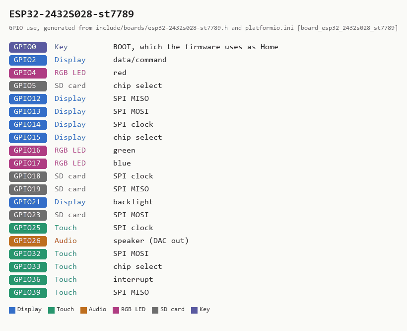

# ESP32-2432S028, ST7789 panel -- 2.8-inch, resistive touch, USB-C and micro-USB

**How to recognise it:** a 2.8-inch "Cheap Yellow Display" with **two** USB
sockets, one USB-C and one micro-USB -- the board the community calls the
**CYD2USB**. Resistive touch, a speaker connector and an RGB LED, and **no
battery hardware the firmware can use**. It is the same board as the
[inverted-panel ESP32-2432S028](ESP32-2432S028-inv.md) in every way but the
glass: the two are sold under the same listings, and only the display
controller differs.

**In the installer:** "2.8-inch, resistive touch, USB-C plus micro-USB, no
battery (USB power) -- ESP32-2432S028 CYD, ST7789 panel".

**Which of the two dual-USB images is yours:** flash this one first. If it
draws every colour wrong -- the dark theme white, green purple -- you have the
ILI9341 glass and want the inverted-panel image. If the inverted-panel image
draws it correctly but washed out, the colours flat rather than vivid, you have
the ST7789 glass and this is your image. Nothing on the board says which; the
screen does.

**Run it from USB power:** a wall adapter, a computer, or a USB power bank for
portable use. There is no battery badge and no low-battery warning on this
board, because there is nothing to read.

## What has been checked on this board

**Run by its reporter, not by the maintainer, who does not own this glass.**
The profile was written from the configuration the reporter of
[issue 200](https://github.com/iamankushpandit/Gume/issues/200) runs the board
with -- the `CYD2USB` setup in witnessmenow's ESP32-Cheap-Yellow-Display
repository: the ST7789 sequence, BGR order, no inversion, backlight on
GPIO21 -- and the first build was handed to them. On 2026-10-21 they reported
it: colours vivid, the dark theme dark, touch landing where tapped, all four
rotations right, and red drawn as blue. Red and blue exchanged with nothing
else wrong is the colour-order bit, so the order is RGB and the second build
carries that; this paragraph is updated when the reporter has run it.
Everything that is not the display is carried over from the inverted
sibling, which is the same PCB and has been measured: touch, backlight,
rotation, the RGB LED order, no battery sense (GPIO34 is the light sensor),
DAC audio on GPIO26, 4 MB flash. The SD pins are inherited from the E32R28T-1
and have not been exercised.

## Sources

Checked 2026-10-20. Neither source states a licence for its pictures, so these
are linked, not copied.

| Source | Archived copy | What it gives |
|---|---|---|
| [witnessmenow: ESP32-Cheap-Yellow-Display, DisplayConfig/CYD2USB](https://github.com/witnessmenow/ESP32-Cheap-Yellow-Display/tree/main/DisplayConfig/CYD2USB) | -- | the TFT_eSPI setup for this glass: ST7789, BGR, no inversion, backlight GPIO21 |
| [Random Nerd Tutorials: ESP32 Cheap Yellow Display (ESP32-2432S028R)](https://randomnerdtutorials.com/cheap-yellow-display-esp32-2432s028r/) | none found | the CYD family's pins (touch, backlight, RGB LED, light sensor on GPIO34) |
| [XPT2046 datasheet (PDF)](https://www.lcdwiki.com/res/PublicFile/XPT2046.pdf) | -- | touch controller |

<!-- BEGIN GENERATED by tools/gen_board_docs.py -- do not edit by hand -->

### From the firmware profile

| | |
|---|---|
| Firmware name (`BOARD_NAME`) | `ESP32-2432S028-st7789` |
| Installer / PlatformIO environment | `app_esp32_2432s028_st7789` |
| Device-id tag | `CYD789-...` |
| Panel | 240 x 320, ST7789 driver |
| Touch | resistive XPT2046, its own bit-banged SPI bus |
| Sound | built-in DAC on GPIO26, into an onboard amplifier |
| Battery sense | **none** -- no battery badge; run it from USB power |
| Flash | 4 MB |

| GPIO | Used for |
|---|---|
| 0 | Key: BOOT, which the firmware uses as Home |
| 2 | Display: data/command |
| 4 | RGB LED: red |
| 5 | SD card: chip select |
| 12 | Display: SPI MISO |
| 13 | Display: SPI MOSI |
| 14 | Display: SPI clock |
| 15 | Display: chip select |
| 16 | RGB LED: green |
| 17 | RGB LED: blue |
| 18 | SD card: SPI clock |
| 19 | SD card: SPI MISO |
| 21 | Display: backlight |
| 23 | SD card: SPI MOSI |
| 25 | Touch: SPI clock |
| 26 | Audio: speaker (DAC out) |
| 32 | Touch: SPI MOSI |
| 33 | Touch: chip select |
| 36 | Touch: interrupt |
| 39 | Touch: SPI MISO |

### Photos

None yet. Add your own as `docs/boards/img/ESP32-2432S028-st7789-front.jpg` (and `-back.jpg`)
and re-run `python tools/gen_board_docs.py`.

<!-- END GENERATED -->

<!-- SPDX-License-Identifier: GPL-3.0-or-later -->
<!-- SPDX-FileCopyrightText: Copyright (C) 2026 iamankushpandit -->

---

*Part of [Braino!](https://github.com/iamankushpandit/Gume) by [iamankushpandit](https://github.com/iamankushpandit). Copyright © 2026 iamankushpandit, licensed [GPL-3.0-or-later](https://github.com/iamankushpandit/Gume/blob/main/LICENSE) alongside the code — reuse of this document, in whole or in part, must keep this attribution and stay under the same licence. See [NOTICE.md](https://github.com/iamankushpandit/Gume/blob/main/NOTICE.md).*
